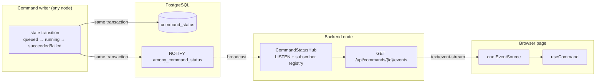

# Realtime Command Status

This document describes how to replace the current polling of `command_status` with `LISTEN`/`NOTIFY` and Server-Sent
Events (SSE). It is a design sketch, not an implementation plan with dates.

## Problem

Today a waiting client and the server both poll:

- The frontend calls `GET /api/commands/{id}` about once per second while a command runs.
- `CommandBus.subscribe` (and therefore `awaitCompletion`) polls `command_status` every 200 ms.

For each waiter that is one HTTP request per second and one primary-key lookup per second. The lookups are cheap, but
the request overhead, connection churn and database round-trips scale with the number of waiters. Moving the poll to the
server with `awaitCompletion` does not remove it; it relocates the same queries and additionally holds a request open
for the duration of the operation.

The steady state we want is: the server tells each client when its command changes, and nobody polls.

## Goal

- One `NOTIFY` per command state transition, in the same transaction as the transition.
- One `LISTEN` connection per backend node, independent of the number of waiters.
- One SSE stream per page instead of one poller per command.
- The existing `GET /api/commands/{id}` endpoint stays as the source of truth and the fallback.

## Overview



The existing `amony_<topic>` channel on `message_log` is unrelated: it wakes up consumers. This design adds a separate,
global channel for command status observers.

## 1. Notify on every state change

Every transition already happens in a single SQL statement:

| Transition       | Where                                      |
| ---------------- | ------------------------------------------ |
| `queued`         | `CommandBus.submit` inserts the status row |
| `running`        | `CommandStore.claim`                       |
| `queued` (retry) | `CommandStore.requeue`                     |
| `succeeded`      | `CommandStore.succeed`                     |
| `failed`         | `CommandStore.fail`                        |

Append a notification to the same statement or transaction:

```sql
select pg_notify('amony_command_status', topic || ':' || command_id);
```

Key properties:

- `NOTIFY` is transactional, so a notification is only delivered after the transition commits and in commit order. A
  subscriber can never observe an uncommitted state.
- The payload is only the identity of the command. `NOTIFY` payloads are limited to 8000 bytes; the subscriber reads the
  row for the current state.
- `purge` does not notify: terminal states have already been delivered, and a subscriber that attaches after that reads
  the row when it registers.

## 2. Per-node `CommandStatusHub`

A single component per node:

1. Opens one dedicated `LISTEN amony_command_status` session at startup and keeps it for the process lifetime.
2. Keeps a registry of subscribers, for example `MapRef[IO, CommandId, Set[Queue[IO, CommandStatus]]]`.
3. On a notification, reads the `command_status` row by primary key, fans the snapshot out to that command's
   subscribers, and removes the entry once the command is terminal.
4. On `subscribe(id)`, **reads the row first**, then registers. The initial read is what makes the design correct when
   the terminal notification happened before the client connected.
5. Optionally runs a slow reconciliation poll (seconds, not milliseconds) while any subscription is active, to recover
   from a dropped notification.

`CommandBus.subscribe` is reimplemented on top of the hub, so its signature does not change. `awaitCompletion` stays
`subscribe(id).takeThrough(!_.isTerminal)`, which means it also stops polling without any API change.

Duplicate notifications (for example a retry that returns to `queued`) are harmless: subscribers only need the latest
snapshot.

## 3. SSE endpoint

Add a streaming endpoint next to the existing status endpoint:

```
GET /api/commands/{commandId}/events
Accept: text/event-stream
```

- Each change is one SSE message, for example `event: status` with the `CommandStatusDto` as JSON. The terminal state is
  delivered as the last event and the server closes the stream.
- The first message is the current status, sent immediately after the subscription is registered. This also handles the
  "command already finished" case.
- Authorization reuses the existing command scoping: the command key maps to a bucket and the bucket's role is checked.
  An unknown or inaccessible command is a 404, exactly like `GET /api/commands/{id}`.
- Send a comment heartbeat (`: ping`) every 15–30 seconds so proxies and load balancers do not close an idle stream.
- SSE reconnects automatically. Because status is a snapshot rather than an event log, the correct resume behaviour is
  simply to send the current row on connect; no `Last-Event-ID` history is required.
- Use a bounded queue per subscriber with drop-oldest. Intermediate states may be dropped; the latest snapshot is what
  matters.
- One stream per watched command is fine at first. If a page watches many commands, add a multiplexed
  `GET /api/commands/events?ids=a,b,c` later.

## 4. Frontend

`useCommand` gains a transport:

- Subscribe to the SSE endpoint instead of calling `getCommandStatus` in a loop.
- The server sends the current status on connect, so no separate initial `GET` is needed.
- On stream error, `EventSource` reconnects on its own; while disconnected the hook can fall back to the existing
  polling path.
- Keep the polling implementation behind a flag until the stream has proven stable.

To survive a page reload, the command id has to be persisted (for example in `localStorage`). That is the same
requirement as the deferred "persist queued/running commands" work, and without it a reload still loses the
subscription.

## 5. Failure modes and guarantees

- `LISTEN`/`NOTIFY` is **at-most-once**. Notifications can be lost if a listener connection drops or a queue overflows.
  Never use it for correctness: `command_status` is the source of truth, the initial read on attach is mandatory, and a
  slow reconciliation poll is a cheap safety net.
- Multi-node works without coordination: PostgreSQL broadcasts to every listener, so any node can serve an SSE client
  even if another node processes the command.
- Budget one pooled connection per backend node for the `LISTEN` session.
- `NOTIFY` is delivered at commit time, so an SSE event can never race ahead of the data it describes.

## 6. Rollout

1. Add `pg_notify` to the five state transitions. No behaviour change.
2. Add `CommandStatusHub` and implement `subscribe` on top of it. Keep polling as a configuration fallback.
3. Add the SSE endpoint; `GET /api/commands/{id}` remains for clients that prefer polling.
4. Switch `useCommand` to SSE with automatic fallback, then remove the poll loop once it is stable.

## Alternatives

- **Server-side `awaitCompletion` long-poll.** Simple to add as a bounded `?wait=5s` convenience for automation, but a
  long-held request per waiter is worse than short polling for multi-minute remuxes and uploads, and it does not reduce
  database queries.
- **WebSocket.** More machinery than needed for a one-way, snapshot-shaped stream. SSE is a better fit.
- **Client polling.** Keep it as the fallback and for low-volume deployments; it is the simplest thing that works.

## Related

- [Message Bus Performance Improvements](messages-bus-performance-improvements.md) covers throughput levers for the
  durable log itself, which is a separate concern from how observers are notified.
