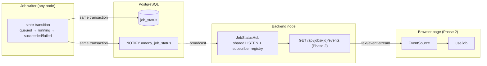

# Realtime Job Status

This document describes how to replace polling of `job_status` with `LISTEN`/`NOTIFY` on the backend, and how to build
Server-Sent Events (SSE) on top if/when long-running jobs move to async HTTP. It is a design sketch, not an
implementation plan with dates.

## Problem

Today `JobBus.subscribe` (and therefore `awaitCompletion`) polls `job_status` every 200 ms. In production,
`awaitCompletion` is currently used synchronously inside HTTP handlers (`fixStreamability` and `uploadResource` in
`ResourceBucketImpl`); there is no `GET /api/jobs/{id}` endpoint or frontend polling yet.

Each waiting call does 5 primary-key lookups per second and incurs up to 200 ms of artificial completion latency on fast
jobs (such as small uploads). If long-running jobs are later exposed asynchronously to the browser, client-side polling
would also add HTTP request overhead and connection churn per waiter.

The steady state we want is:

- **Phase 1 (backend):** `JobBus.subscribe` wakes up on `NOTIFY` instead of polling every 200 ms.
- **Phase 2 (optional, when jobs become async HTTP):** the server streams job transitions to the browser over SSE
  instead of client polling.

## Goal

- One `NOTIFY` per job state transition, in the same transaction as the transition.
- One shared `LISTEN` connection per backend node (multiplexing `amony_<topic>` and `amony_job_status` channels),
  independent of the number of waiters.
- `JobBus.subscribe` and `awaitCompletion` stop polling without changing their API.
- When async HTTP jobs are introduced later, one SSE stream per watched job (or multiplexed per page), with
  `GET /api/jobs/{id}` as the source of truth and fallback.

## Overview



The existing `amony_<topic>` channels on `message_log` wake up consumers. This design adds a separate global channel
`amony_job_status` for job status observers.

## 1. Notify on every state change

Every transition already happens in a single SQL statement:

| Transition       | Where                                  |
| ---------------- | -------------------------------------- |
| `queued`         | `JobBus.submit` inserts the status row |
| `running`        | `JobStore.claim`                       |
| `queued` (retry) | `JobStore.requeue`                     |
| `succeeded`      | `JobStore.succeed`                     |
| `failed`         | `JobStore.fail`                        |

Append a notification to the same statement or transaction:

```sql
select pg_notify('amony_job_status', topic || ':' || job_id);
```

Key properties:

- `NOTIFY` is transactional, so a notification is only delivered after the transition commits and in commit order. A
  subscriber can never observe an uncommitted state.
- The payload is only the identity of the job (`NOTIFY` payloads are limited to 8000 bytes); interested nodes read the
  row for the current state.
- `purge` does not notify: terminal states have already been delivered, and a subscriber that attaches afterward reads
  the row when it subscribes.

## 2. Per-node `JobStatusHub` (Phase 1)

A single component per node:

1. Subscribes to `LISTEN amony_job_status`. Because `MessageTopicImpl` currently pins one `LISTEN` connection per
   consumer group in the message bus pool (`amony.message-bus.pool-size = 8`, 3 already pinned), pair this with
   multiplexing all `LISTEN` channels (`amony_<topic>` and `amony_job_status`) onto **one shared `LISTEN` session per
   node**.
2. Keeps a registry of local subscribers, for example `MapRef[IO, (String, JobId), Set[Queue[IO, JobStatus]]]`.
3. On a notification, **first checks whether any local subscriber is registered** for `(topic, jobId)`. If none, ignore
   the notification so idle nodes do not perform wasted primary-key lookups. Otherwise, read the `job_status` row by
   primary key, fan the snapshot out to that job's subscribers, and clean up once the job is terminal.
4. On `subscribe(id)`, **register the subscriber first, then read the row**, and deduplicate with `.changes` (ending
   with `takeThrough(!_.isTerminal)`). Registering before reading closes the race where a terminal notification arrives
   between the initial read and registration; if the job already finished before subscribe, the initial read delivers
   the terminal state immediately.
5. Runs a slow reconciliation poll (e.g. 5–10 seconds, only while a subscription is active) as a cheap safety net for
   dropped notifications or listener reconnects.

`JobBus.subscribe` is reimplemented on top of the hub, so its signature does not need to change. `awaitCompletion` stays
`subscribe(id).compile.lastOrError.timeout(timeout)` and automatically stops polling and drops the 200 ms latency floor.

Duplicate notifications (for example a retry that returns to `queued`) are harmless: subscribers only need the latest
snapshot.

## 3. SSE endpoint (Phase 2 — only when jobs become async HTTP)

Defer this section and the frontend work below until long-running jobs (such as remuxes) are switched from synchronous
`awaitCompletion` to `202 Accepted` + `jobId`.

Add a streaming endpoint next to a `GET /api/jobs/{jobId}` status endpoint:

```
GET /api/jobs/{jobId}/events
Accept: text/event-stream
```

- Each change is one SSE message, for example `event: status` with the `JobStatusDto` as JSON. The terminal state is
  delivered as the last event and the server closes the stream.
- The first message is the current status, sent immediately after registration. This also handles the "job already
  finished" case.
- Authorization reuses bucket scoping (`ResourceJob.bucketOf(status.key)`): an unknown or inaccessible job returns 404,
  matching `GET /api/jobs/{jobId}`.
- Send a comment heartbeat (`: ping`) every 15–30 seconds so proxies and load balancers do not close an idle stream.
- SSE reconnects automatically. Because status is a snapshot rather than an event log, resuming simply sends the current
  row on connect; no `Last-Event-ID` history is required.
- Use a bounded queue per subscriber with drop-oldest. Intermediate states may be dropped; the latest snapshot is what
  matters.
- One stream per watched job is fine at first. If a page watches many jobs, add a multiplexed
  `GET /api/jobs/events?ids=a,b,c` later.

## 4. Frontend (Phase 2)

`useJob` uses the SSE endpoint when tracking async jobs:

- Subscribe to `GET /api/jobs/{jobId}/events` instead of polling `GET /api/jobs/{jobId}` in a loop.
- The server sends the current status on connect, so no separate initial `GET` is needed.
- On stream error, `EventSource` reconnects on its own; while disconnected the hook can fall back to
  `GET /api/jobs/{jobId}`.
- To survive a page reload, persist active job IDs (for example in `localStorage`) or query active jobs for the bucket.

## 5. Failure modes and guarantees

- `LISTEN`/`NOTIFY` is **at-most-once**. Notifications can be lost if a listener connection drops or a queue overflows.
  Never use it for correctness: `job_status` is the source of truth, register-then-read handles pre-existing terminal
  states without racing, and the slow reconciliation poll recovers from dropped notifications.
- Multi-node works without coordination: PostgreSQL broadcasts to every listener, so any node can serve a waiter even if
  another node processes the job.
- `NOTIFY` is delivered at commit time, so an observer can never race ahead of the committed row.

## 6. Rollout

**Phase 1 (backend only):**

1. Multiplex `MessageBus` `LISTEN` channels onto one shared session per node.
2. Add `pg_notify('amony_job_status', ...)` to the five `JobStore` transitions.
3. Add `JobStatusHub` and implement `JobBus.subscribe` on top of it (with slow reconciliation fallback).

**Phase 2 (when moving long-running jobs to async HTTP):**

4. Add `GET /api/jobs/{jobId}` and `GET /api/jobs/{jobId}/events` (SSE).
5. Switch long-running endpoints to `202 Accepted` + `jobId` and consume them via `useJob`.

## Alternatives

- **Server-side `awaitCompletion` long-poll.** What `fixStreamability` and `uploadResource` do today. Simple for short
  operations, but holding an HTTP request open for multi-minute remuxes risks proxy timeouts and does not survive page
  reloads.
- **WebSocket.** More machinery than needed for a one-way, snapshot-shaped stream. SSE is a better fit.
- **Polling.** Acceptable at very low volume; keep `GET /api/jobs/{jobId}` as the fallback once async jobs exist.

## Related

- [Message Bus Performance Improvements](messages-bus-performance-improvements.md) covers throughput levers for the
  durable log itself, which is a separate concern from how observers are notified.
