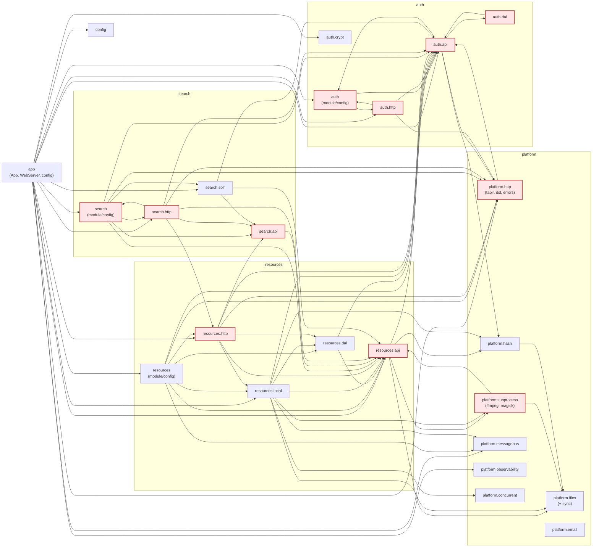
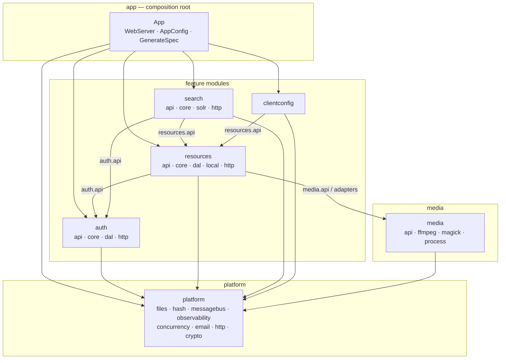

# Backend module boundaries

## Scope and method

This report analyses the current package structure of the Amony backend and proposes logical module boundaries that can
be enforced without splitting the sbt build into subprojects.

The analysis parsed all 128 main source files under `backend` and resolved every internal `import nl.amony...` to the
package that declares the imported symbol. Tests were excluded. The raw result is 32 packages and roughly 100
package-to-package import edges. Fully-qualified references outside imports were checked as well; there were none
outside comments and strings, so imports are a good approximation for this codebase.

For readability, the graph below collapses `platform.subprocess.*`, `platform.tapir.*`, and `platform.files.*` into
single nodes. The business modules are shown at package granularity. Red nodes participate in a cycle at package level,
or in the `resources`/`search` cycle at logical-module level.

## Current package graph



## Findings

### The `auth` module and the HTTP DSL form a six-package cycle

`platform.tapir`, `platform.tapir.dsl`, `auth`, `auth.api`, `auth.dal`, and `auth.http` are in one strongly connected
component. The cycle runs roughly like this:

```text
auth.api → auth (AuthConfig)
auth → auth.http (AuthModule builds AuthRoutes)
auth.http → platform.tapir.dsl
platform.tapir.dsl → auth.api (ApiSecurity, AuthToken, Permission)
```

In addition, `auth.api → auth` because `ApiSecurity` and `TokenManager` use `AuthConfig`, and `auth.api → auth.dal`
because `FederatedLoginService` uses the databases. `auth.dal` also needs `User` and `UserId` from `auth.api`.

The cycle is not fundamental. It has three causes:

- `AuthCookies` lives in `platform.tapir` but depends on auth cookie names.
- Auth-aware `serverLogic` overloads live in the generic Tapir DSL.
- Config and service implementations live in `auth.api` instead of a `core` package.

### The media library and the resource domain form a second cycle

- `platform.subprocess.ffmpeg.tasks.AddFastStart` imports `resources.api.VideoContainer`.
- `resources.api.ResourceMeta` imports `FFProbeModel.FFProbeOutput` and `MagickImageMeta`.

The media-processing library and the resource domain therefore depend on each other. The same area also has a small
`platform.subprocess.magick ↔ platform.subprocess.magick.tasks` cycle.

### `resources` and `search` are cyclic as logical modules

At package level this is not one strongly connected component, because the packages involved are different. At the
logical-module level it is cyclic:

- `resources.http.BucketRoutes` needs `SearchService` and `SearchIndexer` for `reIndex` and `fixNonStreamable`.
- `search.api`, `search.solr`, and `search.http` depend on `resources.api`.
- `search.http` also depends on `resources.http.ResourceDto` and `toDto`.

That is why `SearchModule` has to document the resources/search wiring awkwardness.

### The `api` packages are mixed with implementation

- `auth.api` contains `FederatedLoginService`, `ApiSecurity`, `TokenManager`, and `JwtDecoder`, and imports `auth.dal`
  and `AuthConfig`.
- `resources.api` is closer to a real contract: it contains ports such as `BucketRegistry` and `ResourceBucket`, but
  `ResourceMeta` still parses ffprobe/magick output.
- `AuthToken` has `hasPermission` and `canAccessBucket` methods that require `ApiSecurity`, so a value type depends on a
  service.

### HTTP adapters reach into implementations

- `resources.http` imports `resources.dal.CollectionsDal`, `resources.local.LocalDirectoryBucket`, and `search.api`.
- `search.http` imports `resources.http.ResourceDto` and `toDto`.
- `app` and `GenerateSpec` import `search.solr.SolrConfig`, `auth.crypt.PemReader`, and
  `resources.local.PreviewGenerator`.
- `WebServer` uses `resources.http.ResourceDirectives.responseFromFile` for static assets and `auth.crypt.PemReader` for
  TLS.

These are adapter-to-adapter and adapter-to-implementation edges, not contract dependencies.

### Config placement creates small cycles

`AuthConfig` lives in `auth`, `SearchConfig` in `search`, `SolrConfig` in `search.solr`, and `ResolutionPickingStrategy`
in `resources`. That is why the graph contains `auth ↔ auth.http`, `search ↔ search.http`, and `config → resources`
core.

### Smaller issues

- `platform.email` is currently unreferenced by the application but kept as its own module.
- `modules.config` is one route and depends on `resources` core.
- `GenerateSpec` makes the `app` package depend on every HTTP adapter. It is a build tool, not runtime wiring.
- `app` knows more than a composition root should: `WebServer` imports auth crypto and resources HTTP utilities.

## Proposed logical modules

These are logical modules. Phase 1 implements them as coarse sbt modules: `auth`, `resources`, and `search` each have
their own module, and `clientconfig` currently lives in the app module because it is too small to split off.

| Module         | Contents                                                                                | Public surface  | May depend on                              |
| -------------- | --------------------------------------------------------------------------------------- | --------------- | ------------------------------------------ |
| `app`          | `App`, `WebServer`, `AppConfig`, `GenerateSpec`                                         | —               | all modules                                |
| `auth`         | `api`, `core`, `dal`, `http`                                                            | `auth.api`      | `platform`                                 |
| `resources`    | `api`, `core`, `dal`, `local`, `http`                                                   | `resources.api` | `auth.api`, `media` (see note), `platform` |
| `search`       | `api`, `core`, `solr`, `http`                                                           | `search.api`    | `auth.api`, `resources.api`, `platform`    |
| `media`        | `api`, `ffmpeg`, `magick`, `process`                                                    | `media.api`     | `platform`                                 |
| `platform`     | `files`, `hash`, `messagebus`, `observability`, `concurrent`, `email`, `http`, `crypto` | all             | —                                          |
| `clientconfig` | `ConfigRoutes` and related DTOs                                                         | —               | `resources.api`, `platform.http`           |

`resources.api` may use only `media.api`; `resources.local` may use the `media` adapters.

Proposed package layout:

```text
nl.amony
├── app/
├── auth/
│   ├── api/       UserId, User, Role, Permission, AuthToken, service traits, config
│   ├── core/      AuthModule, ApiSecurity implementation, FederatedLoginService, TokenManager
│   ├── dal/
│   └── http/
├── resources/
│   ├── api/       domain model, ports, shared DTOs, config
│   ├── core/      ResourceModule, DatabaseBucketRegistry, bucket/collection services
│   ├── dal/
│   ├── local/
│   └── http/
├── search/
│   ├── api/       contracts, config
│   ├── core/      SearchModule
│   ├── solr/
│   └── http/
├── media/
│   ├── api/       VideoContainer, ContentProperties, VideoProperties, ImageProperties
│   ├── ffmpeg/
│   ├── magick/
│   └── process/
├── platform/
│   ├── files/
│   ├── hash/
│   ├── messagebus/
│   ├── observability/
│   ├── concurrent/
│   ├── email/
│   ├── http/
│   └── crypto/
└── clientconfig/
```

The key structural rule inside each feature module:

- `api` contains contracts, ports, and config types. It must not depend on `core`, `dal`, `http`, `local`, or `solr`.
- `http` depends on `api` and `platform.http`, not on `core`, `dal`, `local`, or `solr`.
- `core` contains implementations and module wiring. It may depend on `api`, `dal`, `local`, `solr`, and `http` for
  wiring.
- Adapters (`dal`, `local`, `solr`) implement ports from `api` and may depend on `api` and `platform`/`media`.

That last point is important: making `http` depend only on `api` ports is what removes the `auth ↔ auth.http` and
`search ↔ search.http` cycles.

## Target module graph



Allowed dependency rules:

- `platform` must not depend on `modules.*` or `media`.
- `media` must not depend on `modules.*`.
- `auth` must not depend on `resources`, `search`, or `media`.
- `resources` must not depend on `search`; it may use `auth.api`, `media.api`, and `platform`.
- `search` may use `resources.api` only, never `resources.core`, `resources.dal`, `resources.http`, or
  `resources.local`.
- `clientconfig` may use `resources.api` and `platform.http`.
- No module may depend on `app`.
- Inside a module: `api` must not depend on `core`/`dal`/`http`/`local`/`solr`; `http` must not depend on
  `dal`/`local`/`solr`.

## Suggested order of work

1. **Break `platform.http ↔ auth`**
   - Move `AuthCookies` to `auth.http` or `auth.api`.
   - Move the auth-aware `serverLogic` overloads out of `platform.tapir.dsl` into `auth.http` or `auth.tapir`.
   - Move `PemReader` to `platform.crypto`.
   - Move `responseFromFile` to `platform.http` so `WebServer` stops depending on `resources.http`.

2. **Break `platform.subprocess ↔ resources.api`**
   - Move `VideoContainer`, `ContentProperties`, `VideoProperties`, and `ImageProperties` to `media.api`.
   - Move ffprobe and magick JSON parsing to `media.ffmpeg` and `media.magick`.
   - `AddFastStart` can then use `media.api.VideoContainer`, and `resources.api` only depends on `media.api`.

3. **Split `auth.api` into `auth.api` and `auth.core`**
   - `auth.api`: `UserId`, `User`, `Role`, `Permission`, `AuthToken`, `Authentication`, `SecurityInput`, service traits,
     config.
   - `auth.core`: `AuthModule`, `ApiSecurity`, `FederatedLoginService`, `TokenManager`, `JwtDecoder`.
   - Make `AuthToken` a pure value type and move permission checks to `ApiSecurity`.

4. **Break `resources ↔ search`**
   - Move the search-dependent bucket endpoints (`reIndex`, `fixNonStreamable`) into `search.http` admin routes or a
     small `admin` module.
   - Move `ResourceDto` and `toDto` to `resources.api` or a `resources.contract` package so `search.http` no longer
     depends on `resources.http`.
   - Optionally introduce a `ResourceIndexer` port in `resources.api` if resources should keep the endpoints.

5. **Clean up `resources.http`**
   - Replace pattern matches on `LocalDirectoryBucket` with a `BucketMaintenance` capability in `resources.api`.
   - Replace direct `CollectionsDal` use with a `CollectionService` port.
   - Move `ResolutionPickingStrategy` to `resources.api`, so `clientconfig` only depends on `resources.api`.

6. **Move config types out of wiring packages**
   - `AuthConfig` to `auth.api` or `auth.config`.
   - `SearchConfig` and `SolrConfig` to `search.api` or `search.config`.
   - `ResourceConfig` to `resources.api` or `resources.config`.
   - This alone removes several `module ↔ http` cycles.

7. **Keep `platform.email` isolated** in its own module until it is wired into an application flow.

8. **Enforce the result with ArchUnit**
   - `slices().matching("nl.amony.modules.(*)..").should().beFreeOfCycles()`.
   - Explicit rules that `platform` and `media` do not depend on `modules`.
   - Explicit rules that `auth`, `resources`, and `search` only use their allowed contracts.
   - Start with `FreezingArchRule` so existing violations do not block the build, then burn the baseline down.

The biggest win is not a new module name. It is making `*.http` depend on `*.api` ports instead of `*.core`, `*.dal`, or
`*.local`, and moving config types out of the wiring package. That removes most of the cycles without renaming packages.

## Phase 1 implementation

The first steps are implemented on `chore/introduce-modules`:

| sbt module   | Directory             | Contents                                                      |
| ------------ | --------------------- | ------------------------------------------------------------- |
| `app`        | `app`                 | `nl.amony.app` app sources and tests                          |
| `auth`       | `modules/auth`        | `nl.amony.modules.auth.*`                                     |
| `resources`  | `modules/resources`   | `nl.amony.modules.resources.*`                                |
| `search`     | `modules/search`      | `nl.amony.modules.search.*`                                   |
| `email`      | `platform/email`      | `nl.amony.platform.email.*` and its specs                     |
| `files`      | `platform/files`      | `nl.amony.platform.files.*` and its specs                     |
| `subprocess` | `platform/subprocess` | `nl.amony.platform.subprocess.*` (the logical `media` module) |
| `database`   | `platform/database`   | Liquibase evolutions, `DatabaseConfig`, pool/migrations       |
| `messagebus` | `platform/messagebus` | `nl.amony.platform.messagebus.*` and its specs                |
| `tapir`      | `platform/tapir`      | `nl.amony.platform.tapir.*` tapir DSL and error types         |

All modules publish under the `nl.amony` group.

Package names are unchanged. Class-level moves required to keep the module graph acyclic:

- `VideoContainer` stays in `nl.amony.modules.resources.api`; ffmpeg has its own `ContainerFormat` in
  `nl.amony.platform.subprocess.ffmpeg`.
- `AuthCookies` and the auth-aware `serverLogic`/`serverLogicT` helpers moved from `nl.amony.platform.tapir` and
  `nl.amony.platform.tapir.dsl` to `nl.amony.modules.auth.api`.
- The search-backed bucket endpoints (`adminReindexBucket`, `adminFixNonStreamable`) stay in
  `resources.http.BucketRoutes` behind the consumer-owned `resources.api.ResourceIndex` port. `search` implements the
  port, so the modules stay acyclic without the endpoints moving into the search module.
- The database evolutions moved to `platform/database`, but the classpath path stays `db/00-changelog.yaml` and all
  changeSet ids and authors are unchanged. Existing `databasechangelog` rows therefore remain valid.

Most tests remain in the app module; the messagebus specs live in the `messagebus` module. The remaining package-level
cycles are unrelated to the module split.

See [module-systems-and-architecture.md](module-systems-and-architecture.md) for JPMS/OSGi options, ArchUnit
enforcement, and the ports-and-adapters direction.
